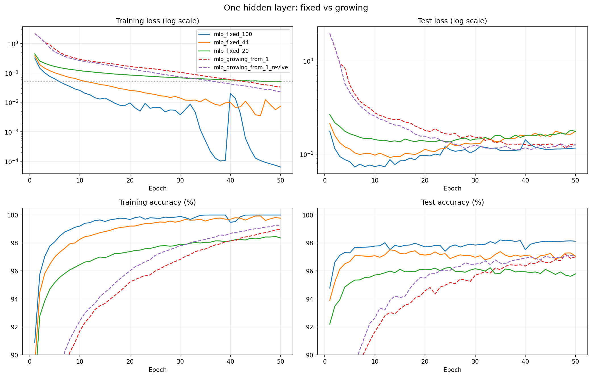
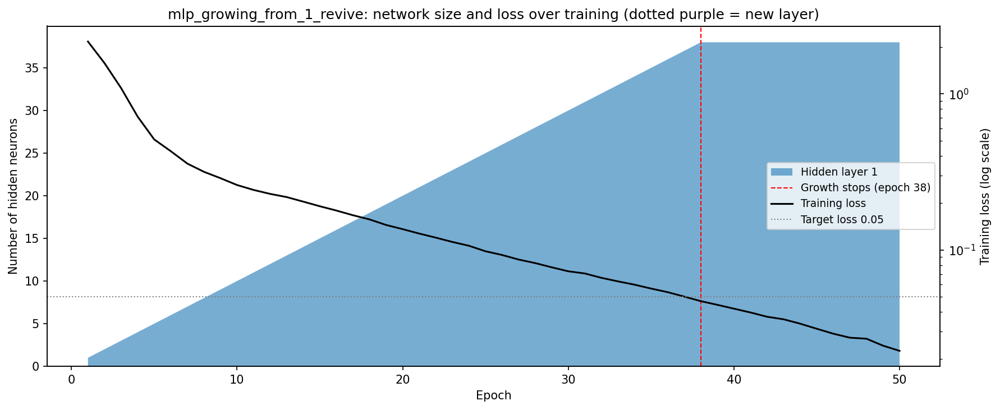
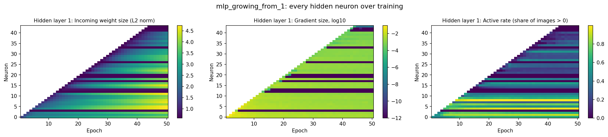
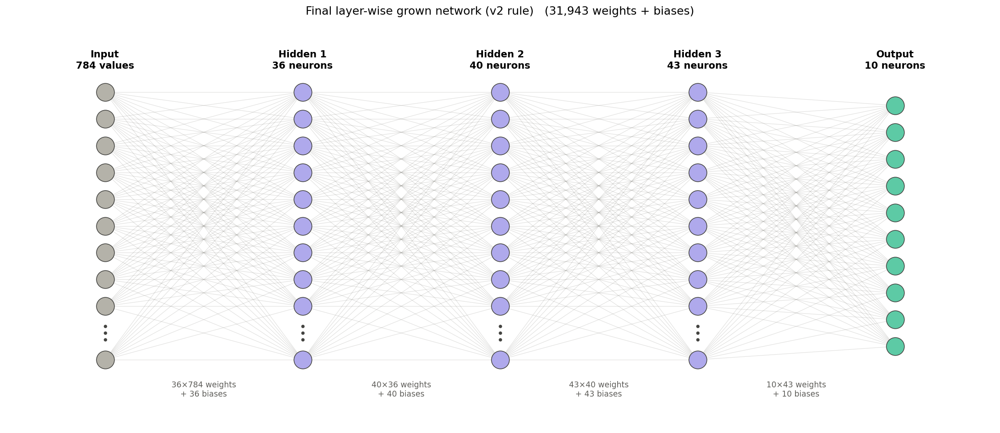

# Dynamically Growing Neural Networks on MNIST

An empirical study of **neuron-wise and layer-wise network growth**. Networks start with a single hidden neuron and add capacity during training until their training loss falls below a target. For every epoch and every neuron, all weights, biases, epoch-averaged gradients and activation statistics are recorded.

---

## Overview

The size of a neural network is normally fixed before training. A growing network instead starts minimal and adds neurons only when its learning progress shows that more capacity is needed. This project continues the author's thesis work (Major Project 2), whose final stage grew a single hidden layer on MNIST while **preserving the learned weights** at every growth step.

Following the supervisor's protocol, the study compares four scenarios on two problems:

| Scenario | One hidden layer | More than one hidden layer |
|---|---|---|
| 1 | fixed, 100 neurons | 2 layers × 100 neurons |
| 2 | fixed, 44 neurons | 2 layers × 44 neurons |
| 3 | fixed, 20 neurons | 2 layers × 20 neurons |
| 4 | grows from 1 neuron on the loss | grows **layer-wise** from 1 neuron |

Two extensions were added in response to what the recorded data revealed: **dead-neuron revival** (Experiment 2b) and a **smoothed plateau rule** for layer-wise growth (Experiment 4b).

## Key results

| Exp. | Network (final) | Parameters | Test acc. @ epoch 50 | Test loss @ 50 | Dead neurons |
|---|---|---|---|---|---|
| 1 | fixed 784-100-10 | 79,510 | **98.13%** | **0.116** | 4 of 100 |
| 1 | fixed 784-44-10 | 34,990 | 97.06% | 0.176 | 1 of 44 |
| 1 | fixed 784-20-10 | 15,910 | 95.79% | 0.176 | 0 of 20 |
| 2 | grown to 784-44-10 | 34,990 | 97.01% | 0.125 | 11 of 44 |
| 2b | grown to 784-38-10, with revival | **30,220** | 97.07% | 0.127 | 1 of 38 |
| 3 | fixed 784-100-100-10 | 89,610 | 97.82% | 0.174 | 5 of 200 |
| 3 | fixed 784-44-44-10 | 36,970 | 97.30% | 0.189 | 3 of 88 |
| 3 | fixed 784-20-20-10 | 16,330 | 95.96% | 0.176 | 1 of 40 |
| 4 | grown layer-wise to 784-24-29-56-10 | 21,815 | 96.29% | 0.147 | 20 of 109 |
| 4b | grown layer-wise to 784-36-40-43-10 | 31,943 | 96.45% | 0.152 | 24 of 119 |

Experiments 4 and 4b train for 100 epochs and reach 96.14% and 96.99% test accuracy at epoch 100; their dead-neuron counts are taken at epoch 100.

**Main findings**

1. **Growth matches a fixed network of the same size.** The network grown from 1 neuron stopped at exactly 44 neurons and reached 97.01% test accuracy at epoch 50, against 97.06% for the fixed 44-neuron network. It used **57% of the computation** (neuron-epochs) and **overfitted less** (test loss 0.125 vs. 0.176).
2. **The per-neuron logs exposed a hidden problem.** 25% of the grown network's neurons were *dead*: permanently inactive, with zero gradient.
3. **Dead-neuron revival fixes it and makes growth more efficient.** With revival, the network reached the target with **38 neurons** (13.6% fewer parameters) at equal accuracy (97.07%), with only 1 dead neuron at the end.
4. **Layer-wise growth works but is fragile.** Function-preserving identity layers (Net2Net) add depth without losing learned knowledge, but the result depends strongly on the plateau rule: a one-epoch rule froze the first layer at 24 neurons (96.14% at epoch 100), while a three-epoch average gave 36 neurons (96.99%). Identity layers also **copy dead neurons into every new layer**. On MNIST, extra depth gives no benefit.
5. **Compute savings did not shorten wall-clock time.** On a GPU, networks this small are limited by data loading, so every 50-epoch run took about 7.3 minutes.

### Selected figures

**Learning curves, one hidden layer.** The fixed networks' test loss rises after its early minimum (overfitting); the growing networks are still improving at epoch 50.



**Growth trajectory with dead-neuron revival (Experiment 2b).** The network grows by one neuron per epoch until the training loss crosses 0.05.



**Every neuron over training (Experiment 2).** Each row is one neuron and each column one epoch; white cells are neurons not yet created. The continuous dark lines are dead neurons, with zero gradient and zero activity.



**Final layer-wise grown network (Experiment 4b).**



All 22 analysis figures are in [`results/plots/`](results/plots/).

## Methods in brief

- **Neuron-wise growth (Experiments 2, 2b).** After every epoch, if the training loss is still at or above 0.05, one hidden neuron is added. All learned weights are copied into the enlarged layers; only the new neuron's incoming weights, bias and outgoing weights are random. Once the target is reached, growth stops and training continues to the epoch budget.
- **Dead-neuron revival (Experiment 2b).** New neurons are re-drawn until they are active on at least 5% of a 2,048-image probe set. After every epoch, neurons active on fewer than 1% of the training images get new incoming weights and zero outgoing weights, so the network's predictions do not change at the moment of revival.
- **Layer-wise growth (Experiments 4, 4b).** Neurons are added to the newest layer. When the loss plateaus (improvement below 0.005, measured over one epoch in Experiment 4 and averaged over three epochs in 4b), a new layer is inserted before the output layer as an identity mapping. For ReLU activations $a \ge 0$, $\mathrm{ReLU}(Ia) = a$, so the inserted layer leaves the network's function unchanged.

**Training setup.** PyTorch on an NVIDIA Tesla T4 (Kaggle); Adam with learning rate 0.001 (re-created after every growth step); batch size 128; cross-entropy loss; ReLU; PyTorch default initialisation; seed 42; no data augmentation; 50 epochs (100 for Experiments 4 and 4b).

## Recorded data

For every run and every epoch:

| File | Content |
|---|---|
| `epoch_XXX.npz` | all weights and biases, and the gradient of each averaged over the epoch's 469 mini-batches (generated when the notebook runs; not stored in this repository because of their size) |
| `neuron_stats.csv` | one row per neuron per epoch: bias; mean, standard deviation and L2 norm of the incoming weights; mean and L2 norm of their gradient; bias gradient; mean pre-activation; active rate |
| `epoch_summary.csv` | one row per epoch: layer sizes, training and test loss and accuracy, time, growth decision |

A neuron's *active rate* is the fraction of training images for which its pre-activation is positive; a neuron is counted as *dead* when this is below 1%.

## Repository structure

```
growing-neural-networks-mnist/
├── growing_neural_networks_mnist.ipynb   # the complete study, with all outputs
├── README.md
├── requirements.txt
└── results/
    ├── summary_table.csv                 # one row per run
    ├── plots/                            # all 22 analysis figures
    └── runs/
        └── <run name>/
            ├── epoch_summary.csv
            ├── neuron_stats.csv
            └── final_network.png         # layer-wise growing runs only
```

Run names: `mlp_fixed_100`, `mlp_fixed_44`, `mlp_fixed_20`, `mlp_growing_from_1`, `mlp_growing_from_1_revive`, `deep_fixed_100x100`, `deep_fixed_44x44`, `deep_fixed_20x20`, `deep_growing_layerwise`, `deep_growing_layerwise_v2`.

## How to run

### On Kaggle (recommended)

1. Create a new Kaggle notebook and import `growing_neural_networks_mnist.ipynb` (**File → Import notebook**).
2. In **Session options**, set **Accelerator: GPU** and **Internet: On** (MNIST is downloaded on first use; Internet access requires a phone-verified Kaggle account).
3. Click **Save Version → Save & Run All (Commit)**. The complete notebook takes about 90 minutes on a T4 GPU.
4. Open the saved version. Its **Output** section contains `results_for_report.zip` and all log files, including the `.npz` snapshots.

Do not re-run a single training cell in an interactive session after the full run: each run rewrites its log files, and a partial re-run would overwrite complete results.

### Locally

```bash
pip install -r requirements.txt
jupyter notebook growing_neural_networks_mnist.ipynb
```

The notebook writes to Kaggle paths. Before running elsewhere, change:

- `DATA_ROOT` and `OUT_DIR` in the first code cell (Section 3.1);
- `OUT_DIR` in the first cell of Section 5;
- `pack_dir` and the archive path in Section 5.8.

A CUDA GPU is strongly recommended; on a CPU the complete study takes many hours.

## Limitations

Every configuration was trained once (seed 42), so differences of a few tenths of a percentage point should not be over-interpreted. MNIST is simple enough that one small hidden layer suffices, so conclusions about depth need a harder dataset. The growth target and the plateau and dead-neuron thresholds were chosen by hand.

## Future work

- Repeat both problems on **CIFAR-10**, where depth is expected to matter.
- Revive dead neurons **before** inserting an identity layer, so that none are copied.
- Carry Adam's state over to the enlarged network instead of restarting the optimiser.
- Train every configuration with several seeds and report confidence intervals.
- Use the recorded gradient statistics to decide where and when to grow, and combine growth with pruning.

## References

1. T. Chen, I. Goodfellow and J. Shlens, "Net2Net: Accelerating Learning via Knowledge Transfer," *ICLR*, 2016.
2. D. P. Kingma and J. Ba, "Adam: A Method for Stochastic Optimization," *ICLR*, 2015.
3. Y. LeCun, L. Bottou, Y. Bengio and P. Haffner, "Gradient-Based Learning Applied to Document Recognition," *Proceedings of the IEEE*, 86(11), 1998.
4. L. Lu, Y. Shin, Y. Su and G. E. Karniadakis, "Dying ReLU and Initialization: Theory and Numerical Examples," *Communications in Computational Physics*, 28(5), 2020.
5. U. Evci, B. van Merriënboer, T. Unterthiner, M. Vladymyrov and F. Pedregosa, "GradMax: Growing Neural Networks using Gradient Information," *ICLR*, 2022.

## License

© 2026 Manoj Singh Rawat. All rights reserved.

No license is granted for this repository. You may view the code and results on GitHub, but you may not copy, modify or redistribute them without the author's written permission.
